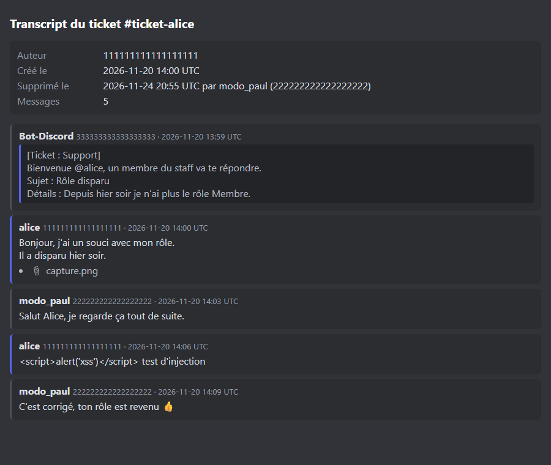

# Bot-Discord

**Bot Discord tout-en-un, sécurisé, en français et en anglais** : modération, tickets, animation. Tout se configure avec `/config`, et le bot ne demande jamais la permission Administrateur.

| 🛡️ Modération | 🎫 Tickets | 🎉 Animation |
|---|---|---|
| Ban avec confirmation, ban temporaire (déban automatique), kick, mute, warns | Types de tickets, formulaire à l'ouverture, prise en charge | Giveaways (tirage équitable, survit aux redémarrages) |
| Historique par membre, sanctions automatiques | Transcript texte + HTML, pièces jointes, note de 1 à 5 | Rôles à boutons, sondages natifs |
| `/lock`, `/slowmode`, règles AutoMod natives | Fermeture des tickets inactifs, `/stats` | Annonces programmées, bienvenue / au revoir |

**Sécurité** : hiérarchie des rôles revérifiée à chaque action, aucune mention @everyone possible, transcripts sans XSS, données effacées 30 jours après le départ du bot (`/privacy`), CI avec tests, lint, audit des dépendances et image Docker non root.



> Mettre le bot en avant (top.gg, serveur de support, vérification) : voir [docs/vitrine.md](docs/vitrine.md).

## Installation

1. Crée une application sur le [Discord Developer Portal](https://discord.com/developers/applications), ajoute-lui un bot et récupère son token (*Bot > Reset Token*).
   **Obligatoire** : dans *Bot > Privileged Gateway Intents*, coche **Server Members Intent** (messages de bienvenue, giveaways). Sans lui, Discord refuse la connexion (code 4014) et le bot l'indique dans la console.
2. Invite le bot avec le lien donné par `npm run invite` (après l'étape 3) : il demande seulement les **permissions minimales** et affiche à quoi sert chacune (jamais Administrateur). Une fois le bot en ligne, `/invite` donne le même lien.
   Le rôle du bot doit être placé **au-dessus** des rôles qu'il doit modérer.
3. Copie `.env.example` en `.env` et remplis-le :
   ```
   DISCORD_TOKEN=ton_token
   TICKET_STAFF_ROLE_ID=id_du_role_staff   (optionnel)
   ```
   Le fichier `.env` est ignoré par git : **ne mets jamais ton token dans le code**.
4. Installe, enregistre les slash commandes puis lance (Node.js 22.13 ou plus) :
   ```
   npm install
   npm run deploy
   npm start
   ```

## Slash commandes

Les commandes ne sont plus enregistrées à chaque démarrage. Relance `npm run deploy` seulement après avoir ajouté ou modifié une commande.

| Commande | Effet |
|---|---|
| `npm run deploy` | Enregistre les commandes sur tous les serveurs (peut prendre un moment à apparaître) |
| `npm run deploy -- --guild ID` | Enregistre sur un seul serveur, immédiatement (pratique pour tester) |
| `npm run deploy -- --guild ID --clear` | Retire les commandes de ce serveur (à faire après les tests, sinon elles apparaissent en double) |

## Tickets

1. `/setticket categorie:<catégorie> staff:<rôle>` (optionnel, demande Gérer le serveur + Gérer les salons + Gérer les rôles) : choisit où créer les tickets et quel rôle les gère. On ne peut choisir qu'un rôle inférieur au sien. Sans configuration, les tickets vont dans la catégorie du panneau et le rôle staff est `TICKET_STAFF_ROLE_ID` du `.env`. `/setticket` seul affiche la configuration, `reinitialiser:True` la remet par défaut.
2. (Optionnel) `/tickettype action:Ajouter nom:Support description:… categorie:… staff:…` : jusqu'à 10 types de tickets, chacun avec sa catégorie et son rôle staff. Le panneau affiche alors un menu déroulant au lieu du bouton.
3. `/ticket action:Poster le panneau ici` poste le panneau (il faut « Gérer les messages »). Repostez-le après avoir ajouté ou retiré un type.
4. (Optionnel) `/setticket inactivite:3` : un ticket sans message d'un membre depuis 3 jours reçoit un avertissement, puis il est fermé 24 h après s'il n'y a pas de réponse.

À l'ouverture, le membre remplit un **formulaire** (sujet + détails), affiché en tête du ticket avec deux boutons :
- **Prendre en charge** (staff) : un seul membre du staff à la fois, un nouveau clic libère le ticket. Un membre avec « Gérer les salons » peut reprendre un ticket déjà pris.
- **Fermer le ticket** : voir plus bas.

Dans un ticket, le staff peut faire `/ticket action:Ajouter membre:@x` ou `action:Retirer` (10 membres ajoutés au maximum, l'auteur ne peut être ni ajouté ni retiré).

Après la suppression, l'auteur reçoit en MP une demande de **note de 1 à 5** (valable 7 jours, une seule fois). `/stats` (Gérer le serveur) résume les 30 derniers jours : tickets ouverts, fermés, délai moyen de prise en charge, note moyenne, répartition par type, staff le plus actif.

Règles :
- **Un** ticket ouvert par membre, 10 min minimum entre deux, 50 tickets max par serveur.
- Le salon n'est visible que par son auteur, le bot, le rôle staff (celui du type, sinon celui de `/setticket`) et les administrateurs. Sans rôle staff, seuls les administrateurs (et les membres avec « Gérer les salons ») voient les tickets. Modifier un type ne change pas les tickets déjà ouverts.
- Quand l'auteur ferme son ticket, il perd seulement l'accès : le salon est renommé `ferme-…` et le staff garde l'historique.
- Quand le staff supprime un ticket, le bot demande une confirmation puis envoie un **transcript** (.txt et .html lisible, 1000 derniers messages, 7 Mo max ; dans le HTML, tout le texte des membres est échappé et la page ne charge rien d'extérieur, voir [l'aperçu](docs/apercu-transcript.png)) et une copie des **pièces jointes** (40 Mo max) dans le salon de logs (`/setlogs`) avant de supprimer. Si l'envoi échoue, le ticket n'est pas supprimé.
- Pour que le transcript contienne le texte des messages, active **Message Content Intent** dans le Developer Portal (*Bot > Privileged Gateway Intents*). Sans lui, le transcript garde les auteurs, les dates et les pièces jointes, mais pas le texte.

## Configuration et langues

- **`/config`** (Gérer le serveur) ouvre une fenêtre privée avec des menus : langue, couleur des embeds, **modules** (activer ou désactiver la Modération, la Communauté et chacun de ses sous-modules, limiter les jeux à certains salons ; administrateur uniquement), **rôle staff** (ses membres peuvent utiliser `/warn`, `/warns`, `/unwarn` et `/historique` ; à choisir avec « Gérer le serveur » + « Exclure temporairement »), salon de logs, tickets (catégorie, rôle staff, fermeture des inactifs), texte du panneau de tickets, et un résumé du reste. Elle applique exactement les mêmes règles que les commandes (`/setlogs`, `/setticket`) : par exemple, changer la config des tickets demande toujours Gérer le serveur + les salons + les rôles. Une seule fenêtre par membre, fermée au bout de 5 minutes.
- **Interrupteur d'urgence** : `DESACTIVER=communaute.jeux,commande:quiz` dans le `.env` coupe ces fonctions sur tous les serveurs au prochain redémarrage (en cas de bug grave), sans redéployer.
- **Langues** : le bot parle français ou anglais. Par défaut, il répond dans la langue du client Discord de chaque membre (les messages publics suivent la langue du serveur) ; `/config` permet d'imposer une langue. Les descriptions des commandes sont traduites en anglais (fichier `locales/commandes.en.json`), les messages dans `locales/fr.json` et `locales/en.json`.
  Traduit dans cette version : aide, ping, confidentialité, `/config`, panneau et ouverture des tickets, rôles à boutons, giveaways, messages de bienvenue par défaut. Les réponses des commandes de modération restent en français pour l'instant.
- **Apparence** : couleur des embeds (`#RRGGBB`) et titre/texte du panneau de tickets, à appliquer en repostant le panneau avec `/ticket`.

## Tableau de bord web (facultatif)

Un site pour configurer le bot sans commande : langue, couleur, salon de logs, tickets (catégorie, rôle staff, inactivité), texte du panneau, bienvenue et au revoir. Connexion avec Discord ; seuls les membres qui ont « Gérer le serveur » voient un serveur, et il applique **exactement les mêmes règles** que les commandes (permissions des tickets, hiérarchie des rôles, premium). Il écrit dans la même base que le bot : un changement s'applique tout de suite.

1. Developer Portal > *OAuth2* : copie le **Client Secret** dans `DISCORD_CLIENT_SECRET`, et ajoute `${DASHBOARD_URL}/callback` dans *Redirects* (ex. `http://localhost:3000/callback` en dev).
2. Renseigne `DASHBOARD_URL` (origine exacte, sans `/` final) et lance `npm run dashboard:dev`, puis ouvre l'URL.
3. En prod (Docker) : `docker compose up -d` lance aussi le service `dashboard`, qui n'écoute que sur `127.0.0.1:3000`. Mets un reverse proxy HTTPS devant, par exemple avec Caddy :
   ```
   bot.exemple.fr {
       reverse_proxy 127.0.0.1:3000
   }
   ```
   avec `DASHBOARD_URL=https://bot.exemple.fr` et `DASHBOARD_TRUST_PROXY=1` (déjà dans `.env.prod.example`).

Sécurité : sessions côté serveur (cookie `__Host-` HttpOnly, Secure, SameSite), jeton CSRF + vérification de l'origine sur chaque envoi, droits revérifiés à chaque requête (pas d'accès au serveur d'un autre), aucun script dans les pages (CSP stricte), limite de débit par IP, aucune dépendance ajoutée. Les sessions sont en mémoire : un redémarrage du site déconnecte tout le monde.

## Premium (facultatif)

Sans configuration, **tout est gratuit** (bot auto-hébergé). Pour vendre un abonnement par serveur avec les Premium Apps de Discord, renseigne `PREMIUM_SKU_ID` : la création de types de tickets, le transcript HTML, `/stats` et la personnalisation (couleur, texte du panneau) deviennent premium, avec le bouton d'achat natif de Discord. **La modération et la sécurité ne sont jamais payantes.** `/premium` affiche le statut du serveur ; `PREMIUM_GUILD_IDS` offre le premium à des serveurs ; `npm run premium:test -- --env=dev --guild ID` donne un premium de test sans payer. Conditions de Discord, mise en place et points légaux : [docs/monetisation.md](docs/monetisation.md).

## Animation

- **Rôles à boutons** : `/roles action:Créer texte:Notifications` poste un panneau, puis `/roles action:Ajouter panneau:<ID> role:@Annonces texte:"🔔 Annonces"`. Les membres cliquent pour prendre ou retirer le rôle (`unique:True` : un seul rôle du panneau à la fois). Par sécurité, un rôle avec une permission de modération ou d'administration (Bannir, Gérer les messages, Administrateur…) ne peut **jamais** être distribué ainsi, et c'est revérifié à chaque clic.
- **Giveaways** : `/giveaway action:Lancer prix:Nitro duree:2d gagnants:1`. Tirage au sort équitable parmi les participants encore présents, même si le bot a redémarré entre-temps. `Relancer` refait un tirage sans les anciens gagnants. Seuls les gagnants sont mentionnés.
- **Sondages** : `/sondage question:"Soirée jeux ?" choix:"Vendredi ; Samedi ; Dimanche" heures:48` (sondage natif de Discord).
- **Annonces programmées** : `/annonce action:Programmer message:… quand:"25/12/2026 18:00"` (heure de Paris) ou `quand:2h`. Au moment de l'envoi, le bot revérifie que l'auteur a toujours le droit d'écrire dans le salon. Aucune mention n'y est active (pas de @everyone).
- **Bienvenue / au revoir** : `/bienvenue action:Configurer type:Bienvenue salon:#accueil message:"Bienvenue {membre} sur {serveur} !"`. Variables : `{membre}`, `{serveur}`, `{nombre}`. Seul le nouveau membre est mentionné ; 10 messages par minute au maximum (anti-raid).

## Données et logs

- Les avertissements, le salon de logs de chaque serveur et le délai entre tickets sont stockés dans une base SQLite locale : `data/bot.db` (ignorée par git, à sauvegarder si tu héberges le bot). Elle utilise `node:sqlite`, intégré à Node : aucune dépendance native à compiler.
- `/setlogs #salon` envoie dans ce salon un résumé de chaque action de modération (qui, quoi, sur qui, pourquoi). Choisis un salon privé : le bot prévient s'il est visible par tout le monde.
- **Sanctions automatiques** : un seuil se déclenche quand le membre atteint *exactement* ce nombre de warns, et seulement si le modérateur qui met le warn a lui-même le droit d'appliquer la sanction (un modérateur qui ne peut que warn ne fait jamais bannir quelqu'un). Un membre qui repasse par le seuil après un `/unwarn` est sanctionné à nouveau.
- **Ban temporaire** : le bot vérifie chaque minute les bans arrivés à échéance. S'il était éteint, il rattrape les débans en retard au démarrage. Si le membre a été débanni ou re-banni à la main entre-temps, le bot ne touche à rien.
- **Vie privée (RGPD)** : `/privacy` résume ce qui est conservé. Quand le bot quitte un serveur, ses données sont effacées 30 jours après (réinvitation par erreur possible sans perte). Un administrateur peut tout effacer tout de suite avec `/privacy supprimer:True`. Pages complètes : [docs/confidentialite.md](docs/confidentialite.md) et [docs/conditions.md](docs/conditions.md) (à compléter avant publication).

## Dev et prod

Utilise **deux applications Discord** (« Bot-Discord DEV » pour tester, et la vraie) avec deux tokens et deux bases séparées. Détails dans [ROADMAP.md](ROADMAP.md) §3.

| | Dev (ton PC) | Prod (serveur d'hébergement) |
|---|---|---|
| Fichier | `.env.dev` (copie de `.env.dev.example`) | `.env.prod` (copie de `.env.prod.example`, `chmod 600`) |
| Commandes | `npm run deploy:dev -- --guild ID_SERVEUR_TEST` | `npm run deploy:prod` |
| Lancement | `npm run dev` | `npm run prod` ou `docker compose up -d --build` |

`npm run dev` refuse de démarrer si `.env.dev` manque : il ne se rabat jamais sur un autre fichier, pour ne pas utiliser le token de prod par erreur.

### Docker (prod)
```
cp .env.prod.example .env.prod && chmod 600 .env.prod   # puis remplir le token
mkdir -p data backups && sudo chown 1000:1000 data backups
docker compose up -d --build
docker compose logs -f
```
L'image tourne sans root, avec un système de fichiers en lecture seule. Le `.env.prod` n'est jamais copié dedans. Docker redémarre le bot s'il plante et le marque « unhealthy » s'il perd la connexion à Discord.

### Sauvegardes
- Automatiques toutes les `BACKUP_INTERVAL_HOURS` heures (24 par défaut en prod) dans `backups/`, en gardant les `BACKUP_KEEP` dernières (7). Chaque sauvegarde est vérifiée avant d'être gardée. Au démarrage, une sauvegarde n'est faite que si la dernière est trop ancienne (un bot qui redémarre en boucle n'écrase donc pas les bonnes sauvegardes).
- Manuelle avec Docker : `docker compose exec bot node scripts/backup.js`. Sans Docker : `npm run backup -- --env=prod`. N'utilise pas `sudo npm run backup` sur une installation Docker : les fichiers créés appartiendraient à root et le bot ne pourrait plus ouvrir sa base.
- **Migrations du schéma** : la base porte un numéro de version (`PRAGMA user_version`) et le bot applique tout seul les fichiers de `migrations/` au démarrage. Avant de migrer une base déjà remplie, il en fait une copie `backups/avant-migration-v<version>-<date>.db` (jamais supprimée par la rotation).
- `npm run migrate -- --etat` affiche la version et les migrations en attente ; `npm run migrate` les applique ; `npm run migrate -- --annuler N --confirmer` revient à la version N (avec Docker : `docker compose exec bot node scripts/migrate.js --etat`).
- **Copie régulièrement `backups/` hors du serveur** (ton PC, un stockage en ligne) : une sauvegarde sur la même machine ne protège pas d'une panne de disque.
- Restauration : arrête le bot, remplace `data/bot.db` par la sauvegarde choisie, supprime `data/bot.db-wal` et `data/bot.db-shm` s'ils existent, relance.

## Vérification

- `npm test` lance le lint (ESLint) puis `npm run check`, qui exécute les tests `node:test` du dossier `tests/` (un fichier par domaine) sans se connecter à Discord : toutes les commandes se chargent, leurs définitions sont valides et les règles de sécurité tiennent.
- `npm run couverture` lance les mêmes tests avec le rapport de couverture de code.
- La CI GitHub Actions lance les mêmes vérifications et `npm audit` à chaque push sur `main` et à chaque pull request, puis construit l'image Docker et vérifie qu'elle tourne sans root et sans aucun secret. Elle ne demande aucun secret.
- Dependabot propose chaque semaine les mises à jour des dépendances.

## Commandes

Les commandes sont rangées par module dans `Commandes/` : le dossier décide du module.

### 🛡️ Modération (staff uniquement) – `Commandes/Moderation/`

| Commande | Permission requise | Rôle |
|---|---|---|
| `/ban`, `/unban` | Bannir des membres | Bannir (avec confirmation par bouton) / débannir |
| `/tempban membre duree raison` | Bannir des membres | Ban temporaire (1 min à 365 j), déban automatique même après un redémarrage |
| `/historique membre` | Exclure temporairement | Toutes les sanctions d'un membre (warns, mutes, kicks, bans, débans) |
| `/sanctions action …` | Gérer le serveur | Sanctions automatiques : « au 3e warn, mute 1 h », etc. (10 seuils max) |
| `/lock [salon]`, `/unlock [salon]` | Gérer les salons + Gérer les permissions | @everyone ne peut plus écrire ; `/unlock` remet les permissions d'avant |
| `/slowmode duree [salon]` | Gérer les salons | Mode lent (0 = désactivé, 6 h max) |
| `/automod action [valeur]` | Gérer le serveur | Règles AutoMod natives : mots interdits, invitations, mentions en masse, spam |
| `/kick` | Expulser des membres | Expulser |
| `/mute`, `/unmute` | Exclure temporairement | Timeout (28 j max) |
| `/warn` | Exclure temporairement | Avertir (enregistré en base + MP) |
| `/warns membre` | Exclure temporairement | Liste des avertissements d'un membre |
| `/unwarn numero` | Exclure temporairement | Retire un avertissement (pas les siens, ni ceux d'un supérieur) |
| `/setlogs [salon]` | Gérer le serveur | Salon des logs de modération (sans salon : désactive) |
| `/clear` | Gérer les messages | Supprimer 1 à 100 messages |
| `/ticket action [membre]` | Panneau : Gérer les messages ; ajouter/retirer : staff du ticket | Poste le panneau, ajoute ou retire un membre d'un ticket |
| `/setticket [categorie] [staff] [inactivite] [reinitialiser]` | Gérer le serveur + les salons + les rôles | Catégorie, rôle staff et fermeture des tickets inactifs |
| `/tickettype action …` | Gérer le serveur + les salons + les rôles | Types de tickets (10 max), chacun avec sa catégorie et son rôle staff |
| `/stats` | Gérer le serveur | Statistiques des tickets sur 30 jours |

### 🎉 Communauté – `Commandes/Communaute/<Sous-module>/`

Animation (`Communaute/Animation/`) :

| Commande | Permission requise | Rôle |
|---|---|---|
| `/quoi` | aucune | Répond « Feur » |
| `/roles action …` | Gérer les rôles | Panneaux de rôles à boutons (10 panneaux, 25 rôles par panneau) |
| `/giveaway action …` | Gérer le serveur | Lancer, terminer, relancer, annuler un giveaway (10 en cours max) |
| `/sondage question choix` | Gérer les messages | Sondage natif (2 à 10 choix, 1 h à 32 jours) |
| `/annonce action …` | Gérer les messages | Annonces programmées (20 en attente, 60 jours max) |
| `/bienvenue action …` | Gérer le serveur | Messages de bienvenue et d'au revoir |

### ⚙️ Général – `Commandes/General/`

| Commande | Permission requise | Rôle |
|---|---|---|
| `/help [commande]` | aucune | Liste des commandes |
| `/ping` | aucune | Latence du bot |
| `/config` | Gérer le serveur | Configuration interactive : langue, couleur, logs, tickets, panneau |
| `/invite` | aucune | Lien d'invitation (permissions minimales) et serveur de support |
| `/premium` | aucune | Statut premium du serveur, fonctions premium, bouton d'achat |
| `/about` | aucune | Serveurs, version, durée en ligne, liens (support, confidentialité, conditions) |
| `/privacy [supprimer] [moi]` | aucune (suppression : administrateur) | Données conservées, export ou effacement de vos données (`moi`), effacement immédiat des données du serveur |
